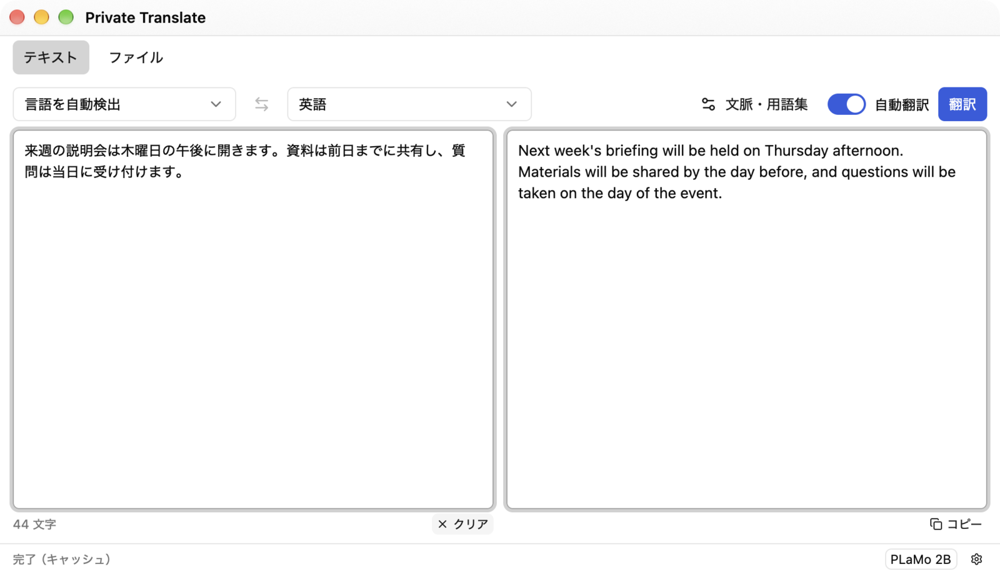

# Private Translate

手元の AI で文書を翻訳

Mac の中で動く AI で、テキスト・PDF・Word・PowerPoint を翻訳するアプリです。無料のオープンソースです。Apple Silicon 搭載の Mac（macOS 13.3 以降）で動きます。

**[最新版をダウンロード](https://github.com/takechanman1228/private-translate/releases/latest)** · [English](README.md)



## できること

- **翻訳は端末内で完結。** 原文と訳文をクラウドに送信しません。
- **翻訳の利用枠なし。** 利用枠や1日あたりの翻訳上限、文字数に応じた料金はありません。
- **文書も翻訳。** テキストのほか、PDF・Word・PowerPoint に対応します。
- **モデルを自動で選択。** Mac のメモリ、言語、ファイル形式に合わせて翻訳モデルを選びます。
- **無料でオープンソース。** アプリに API 利用料や月額料金はかかりません。モデルにはそれぞれ利用条件があります。

## 動作環境とインストール

**必要なもの。** Apple Silicon 搭載の Mac（macOS 13.3 以降）、最初にモデルを取得するためのインターネット接続、モデルの容量に加えて約 1 GB のディスクの空き。主なモデルのダウンロード容量は Hy-MT2 1.8B が 1.13 GB、Index-Translate 2B が 1.31 GB、PLaMo 3 Translate 2B が 1.81 GB、Hy-MT2 7B が 4.62 GB です。メモリ 8 GB の Mac では、Hy-MT2 1.8B と PLaMo 3 Translate で Word、PowerPoint、内蔵エンジンによる PDF を訳せます。Word は Index-Translate 2B でも訳せます。Hy-MT2 7B にはメモリ 16 GB 以上が必要です。

1. [Releases](https://github.com/takechanman1228/private-translate/releases/latest) から `private-translate-<バージョン>-macos-arm64.dmg` をダウンロードして開き、**Private Translate** を **アプリケーション** フォルダーへドラッグします。
2. アプリケーションフォルダーから Private Translate を開きます。インターネットから入手したアプリを開くか確認されたら **開く** を押します。
3. 訳先の言語を確認し、文書を訳す場合は **ファイル** タブから準備します。PLaMo のライセンスに同意する前は、Hy-MT2 が訳先の言語に対応していれば、メモリ 8 GB の Mac では **ファイル** タブで Word・PowerPoint・内蔵 PDF 用に Hy-MT2 1.8B が案内されます。同じ条件でメモリが 16 GB 以上なら、Hy-MT2 7B が案内されます。Hy-MT2 は容量を確認して **準備する** を押します。PLaMo を使う場合は次の手順に進みます。
4. PLaMo 3 Translate を使う場合は、PLaMo コミュニティライセンスへの同意を求められます。商用利用には Preferred Networks（PFN）への事前登録が必要です。利用者または関係会社の年間売上が10億円を超える場合は、PFN との個別の契約が必要です。Hy-MT2 と Index-Translate（Apache-2.0）は登録不要です。
5. 準備が終わったら、**テキスト** に文章を入力または貼り付けます。文書は **ファイル** にドロップして **翻訳** を押します。**保存** を押すと、訳文を別のファイルとして保存します。元のファイルは変更しません。

## 翻訳できる形式と言語

| モデル | 対応する入力 |
| --- | --- |
| PLaMo 3 Translate | 入力・貼り付けたテキスト、TXT、Markdown、Word（`.docx`）、PowerPoint（`.pptx`）、文字を選択できる PDF |
| Hy-MT2 7B（メモリ 16 GB 以上） | 入力・貼り付けたテキスト、TXT、Markdown、Word（`.docx`）、PowerPoint（`.pptx`）、文字を選択できる PDF |
| Hy-MT2 1.8B | 入力・貼り付けたテキスト、TXT、Markdown、Word（`.docx`）、PowerPoint（`.pptx`）、文字を選択できる PDF |
| Index-Translate 2B | 入力・貼り付けたテキスト、TXT、Word（`.docx`）、文脈と用語集を設定していない Markdown |

Hy-MT2 は、英語と次の9言語の間を双方向に翻訳できます（計18方向）。日本語・フランス語・ドイツ語・ブラジルポルトガル語・インドネシア語・アラビア語・簡体字中国語・スペイン語・韓国語です。Index-Translate は英語と、このうち最初の6言語の間を双方向に翻訳できます。

PLaMo は日本語、英語、簡体字・繁体字中国語、韓国語、アラビア語、フランス語、ドイツ語、インドネシア語、スペイン語、ベトナム語など [53言語](https://huggingface.co/pfnet/plamo-3-translate-2b-GGUF#supported-languages)に対応します。

画面の表示言語は英語、日本語、簡体字中国語、繁体字中国語、韓国語、スペイン語、フランス語、ドイツ語、ブラジルポルトガル語、インドネシア語です。英語と日本語は確認済みです。ほかの8言語は母語話者による確認を行っていません。

## アプリの更新

更新の確認は初期設定でオンです。止めるには、設定で **新しい版を確認する** をオフにします。**今すぐ確認** を押すと、いつでも確認できます。新しい版があるときは **更新をダウンロード** を押してください。アプリは取得したファイルの署名、開発チーム、バンドル ID、バージョンを確かめてから、**再起動して X.Y.Z に更新** を表示します。これを押すまで、インストールは行いません。自分でビルドした版では、代わりにリリースページが開きます。

## 通信について

翻訳は Mac の中で行います。原文、訳文、文書、ファイル名を外部に送ることはありません。アプリがインターネットに接続するのは次の場合だけです。

- **モデル一覧**（起動のたびと、モデルの画面で **再確認** を押したとき）。`huggingface.co` から、公開されているモデルの情報を取得します。この通信を止める設定はありません。オフラインのときは、前回保存した一覧を使います。
- **モデルのダウンロード**（**準備する**、**ダウンロード**、**更新** を押したとき）。Hugging Face から取得します。Hugging Face のファイル配信用のサーバーへ転送されることがあります。
- **更新の確認**（初期設定でオン。24 時間に 1 回まで）。起動時、設定をオンにしたとき、**今すぐ確認** を押したときに、GitHub Releases（`api.github.com`）へ問い合わせます。自動の確認を止めるには、設定で **新しい版を確認する** をオフにしてください。**更新をダウンロード** を押すと、もう一度問い合わせたうえで、`github.com` と GitHub のファイル配信用のサーバーから DMG とチェックサムを取得します。

どの通信でも、接続先に IP アドレスが伝わり、User-Agent（`private-translate/X.Y.Z`）でアプリのバージョンを送ります。

モデルを取得したあとは、オフラインで翻訳できます。PDF 用のライブラリとフォントは DMG に入っています。

設定の **PDF エンジン（BabelDOC）** は、このリリースでは配布していない外部エンジンのための項目です。使わなくても問題ありません。設定した場合、エンジンは同じ Mac の中で動き、ループバック接続（`127.0.0.1`）でアプリとテキストをやりとりします。

## モデルとライセンス

- [Hy-MT2](https://huggingface.co/tencent/Hy-MT2-7B-GGUF) と [Index-Translate](https://huggingface.co/IndexTeam/Index-Translate-2B-GGUF) は Apache-2.0 です。
- [PLaMo 3 Translate](https://huggingface.co/pfnet/plamo-3-translate-2b-GGUF) は [PLaMo コミュニティライセンス](https://plamo.preferredai.jp/info/plamo-community-license-ja) で提供されています。最初のダウンロードの前に、アプリが同意を求めます。商用利用には Preferred Networks（PFN）への事前登録が必要です。利用者または関係会社の年間売上が10億円を超える場合は、PFN との個別の契約が必要です。出力を公開する場合は、ライセンスが定める表示が必要です。仕事で使う前に条件を確認してください。

Built with PLaMo.

## 既知の制限

**ファイルの上限。** TXT・Markdown は各 4 MiB。PDF は 32 MiB、100ページ、1ページあたり32,000文字、全体で400,000文字。Word・PowerPoint は各 128 MiB、展開後 512 MiB、4,096項目、処理対象の XML 1部品あたり 8 MiB。フォルダーの一括翻訳は1フォルダーあたり200ファイルまで。

- Hy-MT2 で Word や PowerPoint を訳すと、一部の段落が原文のまま残ったり、段落内の書式を外して訳したりすることがあります。Index-Translate で Word を訳す場合も同様です。Hy-MT2 で内蔵エンジンの PDF 翻訳を使う場合も、原文のまま残る段落があります。確認画面で件数を見られます。
- Index-Translate は長い TXT を区切りごとに独立して訳すため、区切りによって言い回しが変わることがあります。用語をそろえたいときは用語集を使ってください。文脈や用語集を使う Markdown では、自動選択が次に適した取得済みモデルを使います。使えるモデルが準備されていなければ、アプリが対処方法を案内します。Index-Translate を手動で選んだ場合は、両方の欄を空にするか、自動選択に切り替えてください。Index-Translate で訳した Markdown の確認画面で、原文のまま残った行の件数を確認できます。
- 貼り付けた文章の行の長さがそろっている場合は、折り返しと判断した改行をつなぎ、検出した段落の区切りを保ちます。行の長さが不規則な場合は改行が残ることがあります。太字やリンクは保持しません。
- スキャンした PDF は、OCR で文字を認識させてから翻訳してください。アプリに OCR の機能はありません。
- アラビア語・ヘブライ語・ペルシア語・ヒンディー語・ベンガル語・タミル語・タイ語・クメール語・アルメニア語・ジョージア語など、同梱のフォントで表示できない言語に PDF を訳すと、PDF ではなく UTF-8 のテキストファイル（`.txt`）で保存します。
- 起動した直後は、モデルを読み込む間、翻訳できるようになるまで少し時間がかかることがあります。
- Hy-MT2 と Index-Translate で訳した Word、Hy-MT2 で訳した PowerPoint の表示は、LibreOffice のみで確認しています。共有する前に Microsoft Word や PowerPoint でレイアウトを確認してください。
- 配布しているのは Apple Silicon 搭載の Mac 用だけです。Windows 版と Linux 版は配布していません。ソースから Windows や Linux 向けにビルドした場合の動作も確認していません。

## ビルド・テスト・パッケージ作成

Apple Silicon の Mac に Xcode Command Line Tools、rustup 経由の Rust、CMake、Python 3 を導入します。[ツールチェーンファイル](rust-toolchain.toml) が Rust の版と整形・静的検査のコンポーネントを指定します。

```sh
scripts/local-dev.sh build --locked --release -p private-translate
scripts/check.sh
```

ローカル用 DMG の作成には、Metal Toolchain を導入した Xcode 26 以降が必要です（`xcodebuild -downloadComponent MetalToolchain`）。使用中のツールチェーンに Metal がない場合は、`PRIVATE_TRANSLATE_METAL_DEVELOPER_DIR` にその Xcode の `Contents/Developer` を指定してください。アプリ本体のビルドには使用中の SDK が引き続き使われます。パッケージ作成には `metal` と `metallib` が必要です。通常の開発ビルドは埋め込みシェーダーを使うので、Command Line Tools でビルドできます。

`scripts/local-dev.sh install cargo-about --version 0.9.3 --features cli --locked` でライセンス通知の生成ツールを導入します。指定版の [macOS arm64 用 PDFium](https://github.com/bblanchon/pdfium-binaries/releases/tag/chromium%2F8165) と [IPAfont00303](https://moji.or.jp/wp-content/ipafont/IPAfont/IPAfont00303.zip) を取得し、[配布ワークフロー](.github/workflows/release.yml) の SHA-256 と照合します。展開先を `PRIVATE_TRANSLATE_LOCAL_PDFIUM_DIR` と `PRIVATE_TRANSLATE_LOCAL_IPAFONT_DIR` に設定し、`scripts/local-dev.sh package-macos` を実行してください。指定版の Noto フォントを取得し、PDF 用の部品とライセンス通知を同梱したローカル試験用のアドホック署名済み DMG を生成します。

## 不具合を報告する

[GitHub Issues](https://github.com/takechanman1228/private-translate/issues/new/choose) にアプリと macOS のバージョン、モデル、ファイル形式、再現手順を書いてください。ファイルを添付する場合は再現用に作成したデータを使ってください。脆弱性の非公開報告については [SECURITY.md](SECURITY.md) を参照してください。

## ライセンス

アプリは [MIT License](LICENSE-MIT) または [Apache License 2.0](LICENSE-APACHE) のいずれかで利用できます。変更と第三者ソフトウェアの通知については [NOTICE](NOTICE) を参照してください。同梱するライブラリと PDF 用の部品のライセンス通知は DMG に含まれます。
