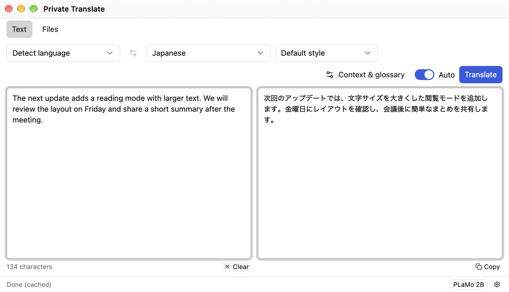

# Private Translate

Local AI document translation

Translate text, PDF, Word, and PowerPoint on your Mac with an AI model that runs locally. Free and open source. Requires an Apple Silicon Mac with macOS 13.3 or later.

**[Download the latest release](https://github.com/takechanman1228/private-translate/releases/latest)** · [日本語](README.ja.md)



## What it does

- **Private by design.** Your source text and translations stay on your device.
- **No translation quotas.** There are no usage quotas, daily caps, or per-character fees.
- **Translates documents.** Work with PDF, Word, and PowerPoint as well as plain text.
- **Chooses a model for you.** Automatic mode considers your computer's memory, the languages, and the file format.
- **Free and open source.** The app has no API fees or subscription. Models have their own licences.

## Install and get started

**You need** an Apple Silicon Mac with macOS 13.3 or later, an internet connection for the first model download, and free disk space for the model plus about 1 GB. Typical downloads are Hy-MT2 1.8B (1.13 GB), Index-Translate 2B (1.31 GB), PLaMo 3 Translate 2B (1.81 GB), and Hy-MT2 7B (4.62 GB). On an 8 GB Mac, Hy-MT2 1.8B and PLaMo 3 Translate can translate Word, PowerPoint and PDFs through the built-in engine. Index-Translate 2B can also translate Word. Hy-MT2 7B needs 16 GB or more.

1. Download `private-translate-<version>-macos-arm64.dmg` from [Releases](https://github.com/takechanman1228/private-translate/releases/latest). Open it and drag **Private Translate** into **Applications**.
2. Open Private Translate from Applications. If macOS asks whether to open an app downloaded from the internet, click **Open**.
3. Check the target language and start from **Files** if you plan to translate documents. Before you accept the PLaMo licence, **Files** recommends Hy-MT2 1.8B on an 8 GB Mac for Word, PowerPoint and built-in PDFs when Hy-MT2 supports the target language. On a Mac with at least 16 GB, **Files** recommends Hy-MT2 7B under the same conditions. Check the download size and click **Prepare** for Hy-MT2. If you use PLaMo, follow the next step.
4. If you use PLaMo 3 Translate, the app asks you to accept the PLaMo Community License. Commercial use requires registering with Preferred Networks (PFN) in advance. If you or your affiliated companies have annual revenue above ¥1 billion, a separate contract with PFN is required. Hy-MT2 and Index-Translate (Apache-2.0) need no registration.
5. When setup finishes, type or paste text in **Text**, or drop a document into **Files** and click **Translate**. **Save** writes the translation as a new file. The original is not changed.

## What it can translate

| Model | Supported input |
| --- | --- |
| PLaMo 3 Translate | Pasted text, TXT, Markdown, Word (`.docx`), PowerPoint (`.pptx`), and PDF with selectable text |
| Hy-MT2 7B (needs 16 GB of memory) | Pasted text, TXT, Markdown, Word (`.docx`), PowerPoint (`.pptx`), and PDF with selectable text |
| Hy-MT2 1.8B | Pasted text, TXT, Markdown, Word (`.docx`), PowerPoint (`.pptx`), and PDF with selectable text |
| Index-Translate 2B | Pasted text, TXT, Word (`.docx`), and Markdown with no context or glossary |

Hy-MT2 supports 18 directions in the app. English can translate both ways with Japanese, French, German, Brazilian Portuguese, Indonesian, Arabic, Simplified Chinese, Spanish, and Korean. Index-Translate supports English in both directions with the first six languages in that list.

PLaMo supports [53 languages](https://huggingface.co/pfnet/plamo-3-translate-2b-GGUF#supported-languages), including Japanese, English, Simplified and Traditional Chinese, Korean, Arabic, French, German, Indonesian, Spanish, and Vietnamese.

The interface is available in English, Japanese, Simplified Chinese, Traditional Chinese, Korean, Spanish, French, German, Brazilian Portuguese, and Indonesian. English and Japanese have been reviewed. The other eight have yet to be checked by native speakers.

## App updates

Update checks are on by default. To stop them, turn off **Check for new versions** in Settings. **Check now** checks at any time. When a new version is available, choose **Download update**. The app verifies the download's signature, developer team, bundle identifier, and version, then shows **Restart to update to X.Y.Z**. Nothing is installed until you press it. Builds you compile yourself open the release page instead.

## Network access

Translation runs on your Mac. Source text, translations, documents, and file names are not sent anywhere. The app goes online only for these:

- **Model list** (every launch, and **Check again** in Models). The app reads public model metadata from `huggingface.co`. This cannot be turned off. Offline, the app uses the list it saved last time.
- **Model downloads** (when you click **Prepare**, **Download**, or **Update**). Models come from Hugging Face, which may redirect to its file storage.
- **Update checks** (on by default, at most once every 24 hours). The app asks GitHub Releases (`api.github.com`) at launch, when you turn checks on, and when you click **Check now**. Turn off **Check for new versions** in Settings to stop the automatic checks. **Download update** asks the API again, then fetches the DMG and checksum from `github.com` and GitHub's download storage.

Each request shows your IP address to that server and sends a User-Agent with the app version (`private-translate/X.Y.Z`).

Once a model is downloaded, translation works offline. The PDF libraries and fonts are already in the DMG.

Settings has a **PDF engine (BabelDOC)** entry for an external engine that is not distributed with this release. You can ignore it. If one is set up, it runs on the same Mac and exchanges text with the app over a loopback connection (`127.0.0.1`).

## Models and licences

- [Hy-MT2](https://huggingface.co/tencent/Hy-MT2-7B-GGUF) and [Index-Translate](https://huggingface.co/IndexTeam/Index-Translate-2B-GGUF) use Apache-2.0.
- [PLaMo 3 Translate](https://huggingface.co/pfnet/plamo-3-translate-2b-GGUF) is under the [PLaMo Community License](https://plamo.preferredai.jp/info/plamo-community-license-en). The app asks you to accept it before the first download. Commercial use requires registering with Preferred Networks (PFN) in advance. If you or your affiliated companies have annual revenue above ¥1 billion, a separate contract with PFN is required. Publishing model output requires the attribution the licence specifies. Read the licence before using the model for work.

Built with PLaMo.

## Known limits

**File limits.** TXT and Markdown up to 4 MiB each. PDF up to 32 MiB, 100 pages, 32,000 characters per page, and 400,000 characters total. Word and PowerPoint up to 128 MiB per file and 512 MiB unpacked, with up to 4,096 entries and 8 MiB per XML part processed. Folder batches include up to 200 files per folder.

- With Hy-MT2, some Word and PowerPoint paragraphs can stay in the source language or be translated without inline formatting. Both can also occur in Word with Index-Translate. Some paragraphs can stay in the source language in built-in PDFs with Hy-MT2. The review screen shows the counts.
- Index-Translate translates each part of a long TXT file independently, so wording can differ between parts. A glossary helps keep terms the same. With context or a glossary, Auto tries the next suitable installed model for Markdown. If no other suitable model is ready, the app explains how to continue. If you picked Index-Translate, clear both fields or switch to Auto. The Index-Translate Markdown review shows how many lines stay in the source language.
- For pasted prose with a consistent line width, the app joins likely line wraps and preserves detected paragraph breaks. Irregular line breaks may remain. Bold and links are not retained.
- Scanned PDFs need a text layer before translation. The app does not perform OCR.
- PDFs translated into languages the bundled fonts cannot display (including Arabic, Hebrew, Persian, Hindi, Bengali, Tamil, Thai, Khmer, Armenian, and Georgian) are saved as a UTF-8 text file (`.txt`), not a PDF.
- Right after the app starts, translation can take a moment to become ready while the model loads.
- Word output from Hy-MT2 and Index-Translate and PowerPoint output from Hy-MT2 were checked only in LibreOffice. Check the layout in Microsoft Word or PowerPoint before sharing.
- Private Translate is released for Apple Silicon Macs only. There are no Windows or Linux builds, and building for them from source is untested.

## Build, test, and package

On an Apple Silicon Mac, install the Xcode Command Line Tools, Rust via rustup, CMake, and Python 3. The [toolchain file](rust-toolchain.toml) selects Rust and its lint and format components.

```sh
scripts/local-dev.sh build --locked --release -p private-translate
scripts/check.sh
```

For a local DMG, use Xcode 26 or later with the Metal Toolchain installed (`xcodebuild -downloadComponent MetalToolchain`). If the active tools lack Metal, set `PRIVATE_TRANSLATE_METAL_DEVELOPER_DIR` to that Xcode’s `Contents/Developer` to select it for the shaders. The app still builds with the active SDK. Packaging requires working `metal` and `metallib` tools. Ordinary development builds use embedded shaders and work with the Command Line Tools.

Install the notice generator with `scripts/local-dev.sh install cargo-about --version 0.9.3 --features cli --locked`. Download the pinned [macOS arm64 PDFium distribution](https://github.com/bblanchon/pdfium-binaries/releases/tag/chromium%2F8165) and [IPAfont00303](https://moji.or.jp/wp-content/ipafont/IPAfont/IPAfont00303.zip). Compare the archives with the SHA-256 values in the [release workflow](.github/workflows/release.yml). Set `PRIVATE_TRANSLATE_LOCAL_PDFIUM_DIR` and `PRIVATE_TRANSLATE_LOCAL_IPAFONT_DIR` to the extracted distribution directories, then run `scripts/local-dev.sh package-macos`. Packaging fetches the pinned Noto fonts, bundles the PDF resources and licence notices, and creates an ad-hoc signed DMG for local testing.

## Report an issue

Use [GitHub Issues](https://github.com/takechanman1228/private-translate/issues/new/choose) for bugs. Include the app version, macOS version, model, file format, and steps to reproduce. Use a synthetic file if an attachment helps. See [SECURITY.md](SECURITY.md) for private vulnerability reports.

## Licence

The app is available under either the [MIT License](LICENSE-MIT) or the [Apache License 2.0](LICENSE-APACHE). See [NOTICE](NOTICE) for change and third-party notices. The DMG includes the full notices for the libraries and PDF resources it bundles.
